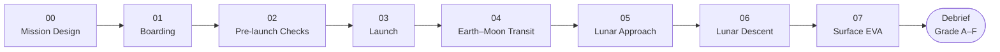

<div align="center">

# 🚀 ORBIT: Mission Architect

### Design it. Launch it. Fly it. Bring the science home.

An educational first-person lunar mission simulator where every engineering decision has a consequence.

<br>


<br>

[**Download**](#-download-and-play) · [**Mission flow**](#-mission-flow) · [**Science**](#-scientific-basis-and-data-honesty) · [**Build**](#-build-from-source) · [**Team**](#-team)

</div>

<br>

<!-- Replace with a real screenshot or GIF of the game, then delete this comment -->
<!-- <p align="center"></p> -->

**ORBIT: Mission Architect** was built in Unity 6 for the **NASA Space Apps Challenge 2026**, challenge *Space Mission Design Game*. The player designs a crewed lunar lander within a mass limit and a budget, then flies it as a crew member through eight mission phases, from the hangar to the Moon's south pole. The trade-offs are the real ones: mass against Δv, power against time, antenna gain against data returned.

> [!IMPORTANT]
> This is a student project. It is not affiliated with, endorsed by, or produced by NASA. Game credits, component capacities and failure rates are gameplay values, not NASA specifications. See [Scientific basis](#-scientific-basis-and-data-honesty).

---

<details>
<summary><b>📑 Table of contents</b></summary>
<br>

- [🎓 What the player learns](#-what-the-player-learns)
- [🌙 Mission flow](#-mission-flow)
- [🧩 Design choices](#-design-choices)
- [🔧 Systems simulated](#-systems-simulated)
- [🔬 Scientific basis and data honesty](#-scientific-basis-and-data-honesty)
- [🎮 Controls](#-controls)
- [📦 Download and play](#-download-and-play)
- [🔨 Build from source](#-build-from-source)
- [📁 Project structure](#-project-structure)
- [🚧 Known limitations](#-known-limitations)
- [🤖 Use of artificial intelligence](#-use-of-artificial-intelligence)
- [📚 Data sources and references](#-data-sources-and-references)
- [👥 Team](#-team)
- [📄 License](#-license)

</details>

---

## 🎓 What the player learns

| Concept | How it appears in the game |
|---|---|
| The rocket equation | Every kilogram added to the ship reduces Δv. The design screen applies Tsiolkovsky's equation, `Δv = Isp · g₀ · ln(m₀ / m_f)`, to the player's own configuration. |
| Margins | A design that only just closes on paper fails in flight when a correction burn or a slow descent uses the reserve. |
| Power budgeting | Solar generation, battery capacity and seven electrical loads share one bus. Switching the wrong load off has consequences hours later. |
| Communications | Antenna gain, pointing error and the landing site's view of Earth set the link margin, which sets how much science data reaches the ground. |
| Life support | Cabin oxygen is consumed and CO₂ builds up if scrubbing loses power. Limits follow published exposure thresholds. |
| Site selection | Each landing site trades sunlight, Earth visibility, terrain hazard and science value. No site is best at everything. |
| Operational discipline | Pre-launch checks, GO / NO-GO calls and anomaly response are part of the mission, not decoration. |

---

## 🌙 Mission flow



| # | Phase | What the player does |
|---|---|---|
| 00 | **Mission Design** | Choose the objective, landing site and launch vehicle, then build the spacecraft within the mass limit and the program budget. |
| 01 | **Boarding** | Walk through the hangar and board the spacecraft. |
| 02 | **Pre-launch Checks** | Verify each console: hatch, power bus, life support, communications, navigation. |
| 03 | **Launch** | Countdown and ascent, including dynamic pressure and throttle-down near Max-Q. |
| 04 | **Earth–Moon Transit** | A 72-hour coast compressed in time: manage power, keep the antenna on Earth, perform trajectory corrections, respond to anomalies. |
| 05 | **Lunar Approach** | Arrive within the capture corridor; a large miss distance costs extra propellant or the mission. |
| 06 | **Lunar Descent** | Manual throttle control of the terminal descent. The safe touchdown speed depends on the site's terrain. |
| 07 | **Lunar Surface EVA** | Leave the cabin, collect samples within the suit's oxygen limit, return and downlink the data. |

The mission ends with a debrief: a score, a grade from **A** to **F**, the crew outcome, and a "reality check" that compares the flight with real mission practice.

---

## 🧩 Design choices

**Objectives**

| Objective | Samples required | Data to downlink |
|---|---|---|
| Scout Sortie | 2 | 120 MB |
| Science Sortie | 3 | 300 MB |
| Flagship Survey | 3 | 600 MB |

**Landing sites** (lunar south polar region)

| Site | Terrain |
|---|---|
| Malapert Massif | Mountain massif |
| Haworth | Crater rim |
| Shackleton Rim | Crater rim |
| de Gerlache Rim 2 | Crater rim |

> [!NOTE]
> Site names follow NASA's published Artemis III candidate regions and LROC imagery. The numerical ratings for illumination, Earth visibility, science and hazard are gameplay estimates. The game does not claim confirmed water ice at any specific location: searching for volatiles is an objective, finding them is not guaranteed.

**Launch vehicles** (generic classes, not real rockets)

| Class | Capacity | Cost |
|---|---|---|
| Medium-lift | 6,600 kg | 20 credits |
| Heavy-lift | 7,400 kg | 30 credits |
| Super heavy-lift | 8,400 kg | 42 credits |

**Spacecraft** — a program budget of 130 credits pays for the launcher and for 16 components across eight slots: suit, life support, battery, solar array, antenna, science camera, propellant tank and engine.

---

## 🔧 Systems simulated

- **Propulsion** — Tsiolkovsky rocket equation with the ship's actual wet and dry mass; propellant is consumed by every burn.
- **Ascent** — altitude and velocity profile based on the Apollo 11 ascent table, dynamic pressure `q = ½ρv²` with an exponential atmosphere.
- **Navigation** — launch dispersion, drift without link or navigation power, mid-course corrections and an arrival penalty that grows with miss distance.
- **Electrical power** — one bus with battery, solar generation scaled by site illumination, and switchable loads (life support, thermal control, communications, navigation, radar, lighting).
- **Communications** — link margin from antenna gain and pointing loss, half-power beamwidth, one-way light time, and a surface penalty for sites with poor Earth visibility.
- **Life support** — cabin oxygen consumption per crew member and CO₂ build-up with caution, warning and failure thresholds.
- **Thermal** — propellant begins to freeze after prolonged loss of thermal control.
- **Terminal descent** — one-dimensional powered descent under lunar gravity (1.62 m/s²) with site-dependent safe touchdown speed.
- **EVA** — suit oxygen supply with an emergency reserve; exertion increases consumption.
- **Anomalies** — antenna drift and solar array faults during the cruise, with a master alarm.
- **Audio** — every sound is synthesized in code at start-up (engine, cabin fans, alarms, Quindar tones, suit ambience). The project ships no audio files.

---

## 🔬 Scientific basis and data honesty

Every value that matters for scientific accuracy is registered in [`DataProvenance.cs`](Assets/_ORBIT/Scripts/Data/DataProvenance.cs) under one of five categories. The interface marks non-real values so the player can tell them apart.

| Category | Meaning | Examples |
|---|---|---|
| **Documented** | Taken from a published source | Lunar gravity; crew oxygen use of 0.82 kg per person per day; CO₂ exposure thresholds; Apollo 11 ascent profile |
| **Standard physics** | Textbook physics or a standard engineering approximation | Rocket equation; light time = range / c; antenna beamwidth; dynamic pressure |
| **Scaled reference** | Structure of a real system, numbers scaled to the game's spacecraft | Solar array and bus architecture; passive thermal control roll; throttle bucket near Max-Q; CO₂ rise rate |
| **Gameplay estimate** | Tuned for play, not measured data | Component masses and costs; site ratings; launcher capacities; downlink rates; descent start conditions |
| **Display only** | Shown on a display but not simulated | Bus voltage; cabin temperature and pressure |

The spacecraft, its components, the credit system and the failure probabilities are fictional. They are designed to make real trade-offs visible, not to reproduce a specific vehicle.

---

## 🎮 Controls

| Input | Action |
|---|---|
| **W A S D** | Move |
| **Mouse** | Look |
| **E** | Interact with a console, hatch, seat or sample |
| **TAB** | Free the mouse to use panels and see details |
| **Click a panel title** | Fold or unfold that HUD panel |

> [!TIP]
> New to the game? Press **TAB** and open the **GUIDE** button on the phase panel: it explains what to do and why it matters.

---

## 📦 Download and play

**Requirements:** Windows 10 or 11, 64-bit.

1. Download the latest build from the [Releases](../../releases) page.
2. Extract the whole `.zip` file to a folder.
3. Run the `.exe` inside that folder.

> [!WARNING]
> Keep the `.exe` together with the `_Data` folder and the other files next to it. It does not run alone.

---

## 🔨 Build from source

**Requirements**

- Unity **6000.6.9f1** (Unity 6.6) with the *Windows Build Support* module
- Universal Render Pipeline, UI Toolkit, TextMeshPro and the Input System package (all resolved by the project's package manifest)

**Steps**

1. Clone the repository.
   ```bash
   git clone <repository-url>
   ```
2. Open the project folder with Unity Hub.
3. If Unity asks to import **TMP Essential Resources**, accept. The 3D console labels need them.
4. Open the scene `ORBIT_Mission` and press **Play**.

**Editor tools** (menu **ORBIT** in the Unity menu bar)

| Menu item | Purpose |
|---|---|
| `ORBIT › Generar assets por defecto` | Regenerates the component and mission assets |
| `ORBIT › Crear escena de prueba` | Rebuilds the mission scene from code |
| `ORBIT › Validar configuraciones de nave` | Checks which spacecraft configurations can complete the mission |

**Windows build:** `File › Build Profiles › Windows › Build`. Confirm that `ORBIT_Mission` is checked in the *Scene List* and that the scene is saved before building.

---

## 📁 Project structure

<details>
<summary><b>Show the folder tree</b></summary>
<br>

```
Assets/_ORBIT/
├── Scripts/
│   ├── Audio/         Procedural sound (no audio files)
│   ├── Core/          Mission director, phase base class, input, Mission Control messages
│   ├── Data/          Mission catalog, component definitions, crew roster, data provenance
│   ├── DevTools/      Camera and development helpers
│   ├── Editor/        Asset generator, scene builder, configuration validator
│   ├── Emergencies/   Anomaly director, antenna drift, solar array fault
│   ├── Interaction/   Consoles and interactable objects
│   ├── Journey/       World state, locations, player placement
│   ├── Phases/        The eight mission phases
│   ├── Player/        Astronaut movement in Earth, cabin and lunar gravity
│   ├── Simulation/    Power bus, ship systems, communications, ascent, trajectory, scoring
│   ├── UI/            HUD, station displays, trajectory view
│   └── Visuals/       Cabin and scene visuals
└── UI/                UI Toolkit style sheets
```

</details>

---

## 🚧 Known limitations

- **Simplified trajectory.** The transit uses a compressed 72-hour timeline and a simplified flight plan; it is not a full patched-conic or n-body solution.
- **Terminal descent only.** The player flies the last 150 m of the descent in one dimension. Orbit insertion, deorbit and braking are abstracted.
- **Fictional spacecraft.** Component masses, costs and reliabilities are balanced for play.
- **Site ratings are estimates.** Illumination and Earth visibility are single values per site, not time-varying maps.
- **Anomalies end at lunar approach.** No random failures occur during descent or the EVA.
- **Single player, Windows only.**

---

## 🤖 Use of artificial intelligence

In line with the NASA Space Apps Challenge rules on AI disclosure:

- **Code:** the C# scripts were written with AI assistance (Anthropic Claude) from the team's original game design. Each file carries a header that states this.
- **Technical review:** AI tools were used to audit the equations, check values against public sources and review documentation.
- **Audio:** generated procedurally by the game's own code, not by an AI audio tool.

<!-- Add here any other AI tool the team used (for example for images or 3D models) and mark those assets as required by the challenge rules. -->

The team defined the game design, selected the sources, tested the builds and is responsible for the final content.

---

## 📚 Data sources and references

- NASA — Artemis III candidate landing regions (2022 and 2024 announcements)
- NASA / Arizona State University — Lunar Reconnaissance Orbiter Camera (LROC) imagery and polar illumination products
- NASA SP-4029, *Apollo by the Numbers* — Apollo 11 ascent and lunar orbit data
- NASA-STD-3001, *Space Flight Human-System Standard* — crew metabolic rates and CO₂ limits
- NIOSH — carbon dioxide exposure limits (STEL and IDLH)
- NASA — Artemis I press kit (tracking and communications architecture)
- ESA / NASA — Orion European Service Module (power system architecture)
- NASA Technical Reports Server (NTRS) — Apollo Lunar Module descent and propulsion reports

<!-- Add the direct links your team cites in the Space Apps project page. -->

---

## 👥 Team

<!-- Replace with the team's name, members and roles -->

| Member | Role |
|---|---|
| _Name_ | _Role_ |
| _Name_ | _Role_ |

NASA Space Apps Challenge 2026 · <!-- local event / city -->

---

## 📄 License

<!-- Choose a license and add a LICENSE file. Until then, all rights are reserved by the team. -->

Third-party content keeps its own license: Unity packages (Unity Companion License) and the TextMeshPro default font Liberation Sans (SIL Open Font License).

---

<div align="center">

Made for the **NASA Space Apps Challenge 2026** 🌕

[⬆ Back to top](#-orbit-mission-architect)

</div>
